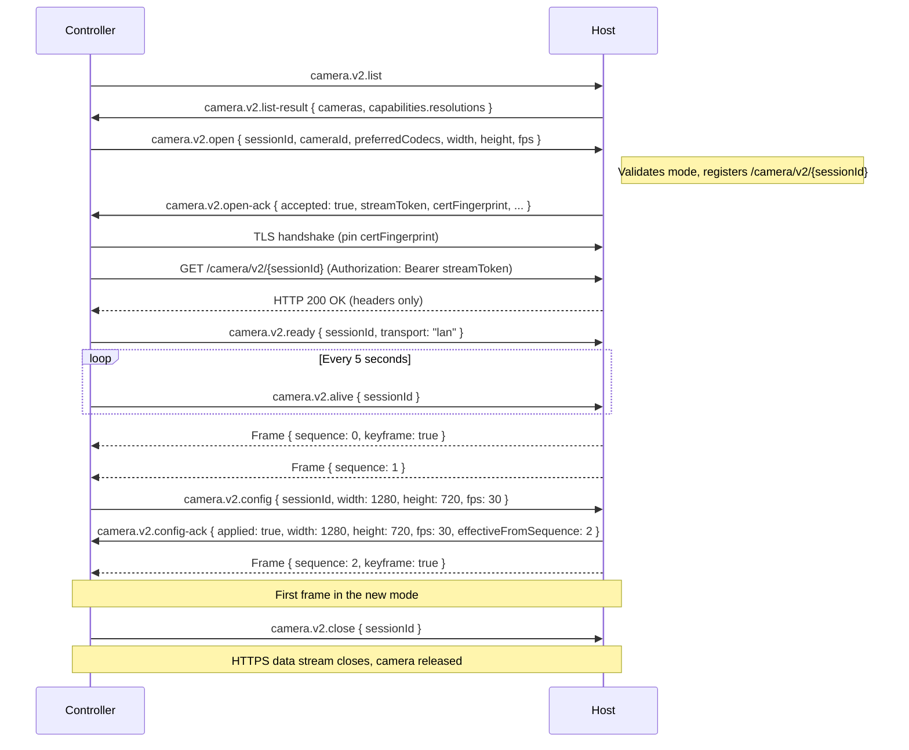
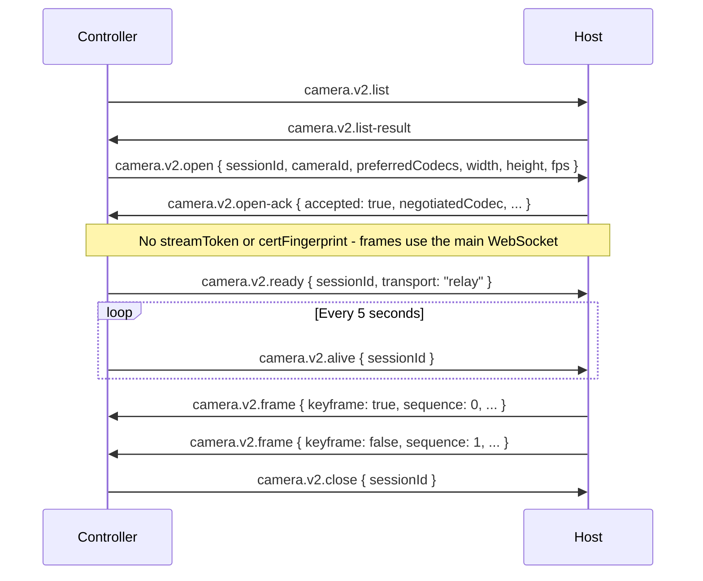
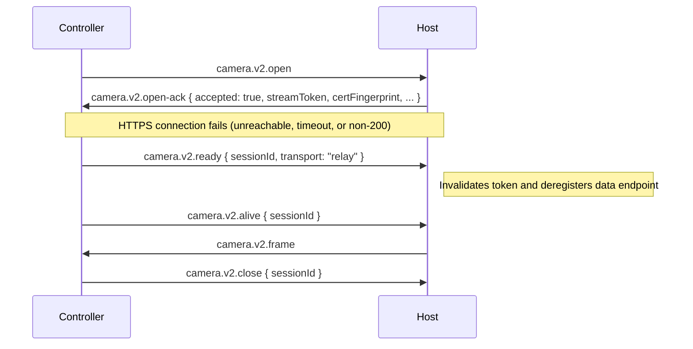
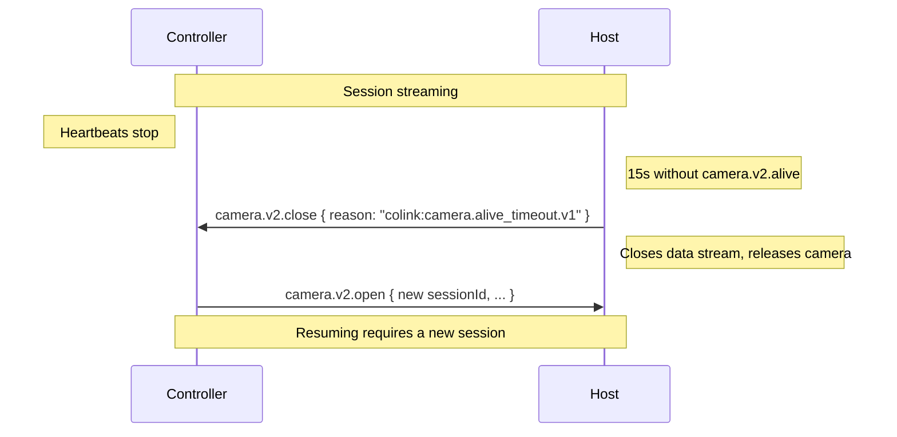

# Remote Camera Stream v2

Stream live video from a host device's camera to a controller device using control/data plane separation with an HTTPS-based LAN data stream.

## Message Type

`camera.v2.*`

## Minimum Business Protocol Version

v1.18.0

When the effective Business Protocol Version (the lower of the controller's and host's advertised versions) is below v1.18.0, implementations MUST use the `camera.v1.*` protocol defined in [`camera.md`](camera.md) instead. See [Version Compatibility](#version-compatibility).

## Design Overview

- **Control plane**: lightweight JSON signaling on the main WebSocket (`list / list-result / open / open-ack / ready / alive / config / config-ack / close`).
- **Data plane (LAN)**: the host serves a continuous binary frame stream over HTTPS on its P2P service port, path `GET /camera/v2/{sessionId}`, secured with a TLS certificate whose fingerprint is pinned through the AEAD-protected direct P2P session.
- **Data plane (relay)**: degraded mode — `camera.v2.frame` as JSON on the main WebSocket.
- **One session = one camera.** A camera can be held by at most one active session at a time on the host.
- **Codec negotiated at open time**: the controller offers a preference list; the host picks one. Frames are self-describing — the binary header's `codec` field identifies the encoding.
- **Promised modes, exact selection**: the host advertises only the video modes (resolution and frame rate) it commits to deliver. The controller selects one of them exactly; the host applies it without clamping or substitution. Quality decisions, including adaptation to network conditions, belong to the controller.
- **Alive-controlled lifetime**: the session stays open only while the controller sends periodic `camera.v2.alive` heartbeats. A missed heartbeat window closes the session; there is no paused state.

## Video Modes

### Capabilities Model

A camera's capabilities are a list of resolutions. Each resolution carries the frame rates the host commits to deliver **at that resolution**. Resolution and frame rate are therefore not independent: a frame rate is valid only together with the resolution that lists it.

```json
{
  "resolutions": [
    { "width": 1920, "height": 1080, "fps": [{ "min": 15, "max": 15 }, { "min": 24, "max": 30 }] },
    { "width": 1280, "height": 720,  "fps": [{ "min": 15, "max": 15 }, { "min": 30, "max": 60 }] },
    { "width": 640,  "height": 360,  "fps": [{ "min": 1,  "max": 30 }] }
  ]
}
```

**Resolution**

| Field  | Type       | Description |
|--------|------------|-------------|
| width  | integer    | Width of the encoded output frame in pixels |
| height | integer    | Height of the encoded output frame in pixels |
| fps    | FpsRange[] | Frame rates the host commits to deliver at this resolution |

**FpsRange**

| Field | Type    | Description |
|-------|---------|-------------|
| min   | integer | Lowest frame rate in the range, inclusive. MUST be ≥ 1 |
| max   | integer | Highest frame rate in the range, inclusive. MUST be ≥ `min` |

A range with `min == max` denotes a single fixed frame rate. A range with `min < max` denotes every integer frame rate from `min` to `max` inclusive.

### Host Rules

- `width` and `height` describe the frames as encoded and transmitted, after any rotation or cropping applied by the host. The controller renders them as received.
- Each listed mode is a commitment: the host MUST be able to deliver every advertised (resolution, frame rate) pair with every codec it may select for that camera. The host MUST NOT list modes it cannot sustain, such as raw sensor modes the encoder cannot handle.
- Modes MUST be determined by hardware and encoder capability only. They MUST NOT depend on the current or expected data transport (LAN or relay), because the transport is selected after `camera.v2.list-result`.
- `resolutions` MUST be non-empty, MUST NOT contain duplicate `width`×`height` entries, and MUST be ordered from the largest to the smallest pixel count.
- Each `fps` array MUST be non-empty. Its ranges MUST NOT overlap and MUST be ordered by ascending `min`.
- A camera for which the host cannot commit to any mode MUST be omitted from `camera.v2.list-result`.

### Mode Matching

A requested (`width`, `height`, `fps`) is **supported** if and only if:

1. `resolutions` contains an entry whose `width` and `height` equal the requested values exactly, and
2. the requested `fps` satisfies `min ≤ fps ≤ max` for at least one range in that entry's `fps` array.

The host MUST validate `camera.v2.open` and `camera.v2.config` with this rule. When a request is supported, the host MUST apply exactly the requested values; it MUST NOT clamp, round, substitute a nearby mode, or lower the values later in the session on its own initiative. When a request is not supported, the host MUST reject it with `colink:camera.unsupported_params.v1`.

## Security

- **sessionId** (UUIDv4, generated by the controller): public session identifier, used to correlate messages across control and data planes.
- **streamToken** (string, generated by the host): one-time bearer credential for the HTTPS data connection in LAN mode. MUST be generated using a CSPRNG with at least 256 bits (32 bytes) of entropy and encoded as base64url without padding. Each token MUST be unique per session and MUST NOT be reused across sessions.
- **certFingerprint** (string, generated by the host): SHA-256 fingerprint of the host's TLS certificate for the HTTPS data endpoint, formatted as `sha256:<lowercase-hex-digest>` over the DER-encoded certificate.

### LAN Offer Precondition

The host MAY offer the LAN data plane only when the control-plane messages for the session are carried over an established, AEAD-protected direct P2P connection. `streamToken` and `certFingerprint` MUST be delivered exclusively over that connection; a `camera.v2.open-ack` carrying them MUST NOT be sent or accepted over Cloud Relay, because the relay server can observe and modify unencrypted relay payloads. When the control plane is carried over Cloud Relay, the host MUST omit both fields and the session uses relay mode.

### TLS Certificate Pinning

The data connection uses the same trust model as [File Transfer v3](file-transfer-v3.md#tls-certificate-pinning):

1. The host uses a self-signed TLS certificate bound to an ephemeral key pair. The certificate MAY be generated per session or per application lifecycle, and MAY be shared with the `file.v3` data endpoint.
2. The controller MUST NOT use CA chain validation. It MUST compute the SHA-256 hash of the DER-encoded certificate presented by the server and compare it with `certFingerprint` from `camera.v2.open-ack`.
3. On mismatch, the controller MUST abort the connection, MUST NOT fall back to relay mode for the session, and MUST send `camera.v2.close` with `colink:camera.tls_pin_mismatch.v1`.

Mutual TLS is not required; the host authenticates the controller through `streamToken`.

### TLS Parameters

Implementations MUST follow [File Transfer v3 TLS Parameters](file-transfer-v3.md#tls-parameters) (TLS 1.3 required, TLS 1.2 ECDHE-ECDSA only, ECDSA P-256 certificate, no validity-period checks).

### Token Lifecycle

- The host MUST register the session's data endpoint before sending an accepted `camera.v2.open-ack` that carries `streamToken`.
- The token is single-use. The host MUST invalidate it on its first successful validation. Any later request for the session MUST be rejected with `401 Unauthorized`.
- The host MUST invalidate the token and deregister the endpoint when the controller selects relay, when the session closes, or when the session ends for any other reason.
- A data connection cannot be resumed. If it is interrupted, the session is closed (see [Data Plane Termination](#data-plane-termination)).

## HTTPS Data Endpoint (LAN)

The host serves the endpoint on its P2P service port (the port advertised via the mDNS `_colink._tcp.local.` SRV record). Connection routing by first byte and the anti-downgrade rules follow [File Transfer v3 Port Multiplexing and Anti-Downgrade](file-transfer-v3.md#port-multiplexing-and-anti-downgrade), with these camera-specific requirements:

- The controller MUST always connect to `/camera/v2/` paths using TLS and MUST NOT attempt plaintext HTTP.
- The host MUST NOT serve `/camera/v2/{sessionId}` over plaintext HTTP. Requests to this path on the plaintext handler MUST be rejected with `421 Misdirected Request`.
- The data connection uses HTTP/1.1.

### Request

```
GET /camera/v2/{sessionId} HTTP/1.1
Host: <hostIp>:<hostPort>
Authorization: Bearer <streamToken>
```

### Successful Response

```
HTTP/1.1 200 OK
Content-Type: application/octet-stream
Cache-Control: no-store

<continuous binary frame stream>
```

- The host MUST send the response status and headers immediately after validating the token, before any frame is available.
- The response body has no defined length. The host MUST NOT send `Content-Length`. It MAY use chunked transfer coding or delimit the body by closing the connection; the controller MUST accept both.
- The frame stream is the decoded response body. Frame boundaries are independent of HTTP chunk boundaries and TLS record boundaries.
- The host MUST NOT write any frame until it has received both `camera.v2.ready` with `transport: "lan"` and the first `camera.v2.alive` for the session.

### Error Responses

| Status | Condition |
|--------|-----------|
| 401 Unauthorized | `Authorization` header is missing or malformed, or the token is invalid or already used |
| 404 Not Found | Session ID is not registered or already deregistered |
| 421 Misdirected Request | Request received on the plaintext handler (TLS required) |

## Binary Frame Format (LAN data stream)

The response body is a sequence of frames. Each frame consists of a 16-byte header followed by its payload. The header layout is identical to [`camera.v1` Binary Data Frame Format](camera.md#binary-data-frame-format-lan-data-connection):

```
Offset  Size  Field
0       1B    version (0x01)
1       1B    kind
2       1B    codec
3       1B    flags
4       4B    sequence number (big-endian u32)
8       4B    timestamp_ms — milliseconds since session start (big-endian u32)
12      4B    payload length (big-endian u32)
16      ...   payload (kind-dependent)
```

The receiver reads a 16-byte header, then reads exactly `payload length` bytes, and repeats until the stream ends.

### Header Rules

- `version` MUST be `0x01`. A controller that receives another value MUST abort the data connection and close the session.
- `sequence` increases monotonically across the session. Gaps MAY occur when the host drops frames (see [Flow Control](#flow-control)); receivers MUST NOT treat gaps as errors.
- A controller MAY abort the data connection and close the session if `payload length` exceeds an implementation-defined limit (recommended: 16 MiB).

### Kind Values

| Value | Name  | Direction         | Payload |
|-------|-------|-------------------|---------|
| 0x01  | frame | host → controller | Encoded video frame bytes |

The data stream is unidirectional; the controller sends nothing on it after the request. The `camera.v1` `cancel` kind (`0x02`) MUST NOT be sent on the v2 data stream; session termination uses the control plane or closes the connection. A controller MUST skip a frame with an unknown `kind` by discarding its payload.

### Codec Values

| Value | Name   | Description |
|-------|--------|-------------|
| 0x01  | `jpeg` | JPEG still image |
| 0x02  | `h264` | H.264/AVC Annex B access unit |
| 0x03  | `webp` | WebP image |

The codec field MUST match `negotiatedCodec` from `camera.v2.open-ack`. New codec values require a Business Protocol minor version bump.

### Flags

| Bit | Name     | Description |
|-----|----------|-------------|
| 0   | keyframe | Set when this frame can be decoded independently (I-frame or full JPEG/WebP image). Receivers that have lost sync MUST wait for the next frame with this bit set before rendering. |
| 1–7 | reserved | MUST be 0 on send; MUST be ignored on receive |

### H.264 Payload Format

When the negotiated codec is `h264`:

- Each frame payload MUST contain exactly one complete H.264 access unit in Annex B byte-stream format.
- Every NAL unit MUST be prefixed with an Annex B start code.
- A frame marked with the `keyframe` flag MUST contain an IDR picture and all SPS/PPS parameter sets required to decode it. The parameter sets MUST precede the picture's VCL NAL units in the same access unit.
- The first frame of a stream MUST be a keyframe. After an applied `camera.v2.config`, the first frame in the new mode MUST also be a keyframe.

Platform codec output that uses a different representation, such as length-prefixed AVC samples or separately supplied parameter sets, MUST be normalized to this format before transmission.

## Flow Control

The stream is real-time; latency takes priority over completeness. These rules apply to both the LAN data stream and relay mode:

- The host MUST NOT buffer frames without bound when the transport cannot accept them. When the outgoing path is congested, the host MUST drop frames rather than queue them.
- For `h264`, after dropping any frame, the host MUST continue dropping until the next keyframe, and SHOULD request a keyframe from the encoder.
- Dropping frames MUST NOT change the session's resolution or frame rate setting. The host MUST NOT lower the mode on its own initiative; the controller observes delivery and sends `camera.v2.config` to change the mode.

## Message Types

| Type | Direction | Description |
|------|-----------|-------------|
| `camera.v2.list` | controller → host | Request available cameras |
| `camera.v2.list-result` | host → controller | Return cameras and their promised modes |
| `camera.v2.open` | controller → host | Open a streaming session in a selected mode |
| `camera.v2.open-ack` | host → controller | Accept or reject the session |
| `camera.v2.ready` | controller → host | Confirm the selected data transport |
| `camera.v2.alive` | controller → host | Session liveness heartbeat |
| `camera.v2.config` | controller → host | Switch to another promised mode mid-session |
| `camera.v2.config-ack` | host → controller | Confirm or reject the mode switch |
| `camera.v2.close` | bidirectional | Close a session |
| `camera.v2.frame` | host → controller | Video frame — relay mode only |

---

## camera.v2.list

Request the list of cameras available on the host device.

```json
{
  "type": "camera.v2.list",
  "payload": {}
}
```

No payload fields required.

### camera.v2.list-result

```json
{
  "type": "camera.v2.list-result",
  "payload": {
    "cameras": [
      {
        "cameraId": "camera-0",
        "label": "Back Camera",
        "position": "back",
        "capabilities": {
          "resolutions": [
            { "width": 1920, "height": 1080, "fps": [{ "min": 15, "max": 30 }] },
            { "width": 1280, "height": 720,  "fps": [{ "min": 15, "max": 15 }, { "min": 24, "max": 60 }] },
            { "width": 640,  "height": 360,  "fps": [{ "min": 1,  "max": 30 }] }
          ]
        }
      }
    ]
  }
}
```

| Field   | Type          | Description |
|---------|---------------|-------------|
| cameras | CameraEntry[] | Available cameras on the host. MAY be empty |

**CameraEntry**

| Field        | Type         | Description |
|--------------|--------------|-------------|
| cameraId     | string       | Opaque device identifier, stable for the lifetime of the session |
| label        | string       | Human-readable camera name |
| position     | string/null  | `"front"`, `"back"`, `"external"`, or `null` when not applicable |
| capabilities | Capabilities | Promised modes. Always present; see [Host Rules](#host-rules) |

**Capabilities**

| Field       | Type         | Description |
|-------------|--------------|-------------|
| resolutions | Resolution[] | Promised resolutions with their frame rates; see [Capabilities Model](#capabilities-model) |

### Notes

- The host SHOULD return all cameras it can enumerate and commit to, including cameras currently held by another session. Such a camera is rejected with `colink:camera.busy.v1` at open time.
- If a camera becomes unavailable between `camera.v2.list` and `camera.v2.open`, the host MUST reject the open with `colink:camera.not_available.v1`.

---

## camera.v2.open

Request a new streaming session on the host in a mode selected from `camera.v2.list-result`.

```json
{
  "type": "camera.v2.open",
  "payload": {
    "sessionId": "a3f1e2d4-58cc-4372-b567-0e02b2c3d479",
    "cameraId": "camera-0",
    "preferredCodecs": ["h264", "webp", "jpeg"],
    "width": 1920,
    "height": 1080,
    "fps": 30
  }
}
```

| Field           | Type     | Required | Description |
|-----------------|----------|----------|-------------|
| sessionId       | string   | Yes      | UUIDv4 generated by the controller; unique per connection |
| cameraId        | string   | Yes      | Camera identifier from `camera.v2.list-result` |
| preferredCodecs | string[] | Yes      | Ordered list of codec names the controller supports; the host picks the first it also supports |
| width           | integer  | Yes      | Frame width; MUST match a promised resolution |
| height          | integer  | Yes      | Frame height; MUST match a promised resolution |
| fps             | integer  | Yes      | Frame rate; MUST fall within a range listed for that resolution |

### Notes

- The controller MUST NOT reuse a `sessionId` within the same connection.
- The controller SHOULD select a mode from the most recent `camera.v2.list-result`. The host validates against its current capabilities using [Mode Matching](#mode-matching).
- The host MUST check rejection conditions in this order: `session_conflict`, `not_available`, `busy`, `no_common_codec`, `unsupported_params`.
- A camera is busy when it is held by any active `camera.v1` or `camera.v2` session on the host, regardless of which controller owns that session.

---

## camera.v2.open-ack

Sent by the host in response to `camera.v2.open`. The `correlationId` in the enclosing transport message MUST reference the `id` of the message that carried the originating `camera.v2.open`.

**Accepted (LAN offered):**

```json
{
  "type": "camera.v2.open-ack",
  "payload": {
    "sessionId": "a3f1e2d4-58cc-4372-b567-0e02b2c3d479",
    "accepted": true,
    "negotiatedCodec": "h264",
    "width": 1920,
    "height": 1080,
    "fps": 30,
    "streamToken": "base64url-encoded-token",
    "certFingerprint": "sha256:a1b2c3d4e5f6..."
  }
}
```

**Accepted (relay only):**

```json
{
  "type": "camera.v2.open-ack",
  "payload": {
    "sessionId": "a3f1e2d4-58cc-4372-b567-0e02b2c3d479",
    "accepted": true,
    "negotiatedCodec": "jpeg",
    "width": 640,
    "height": 360,
    "fps": 15
  }
}
```

**Rejected:**

```json
{
  "type": "camera.v2.open-ack",
  "payload": {
    "sessionId": "a3f1e2d4-58cc-4372-b567-0e02b2c3d479",
    "accepted": false,
    "reason": "colink:camera.unsupported_params.v1",
    "message": "1920x1080@60 is not a promised mode for camera-0"
  }
}
```

| Field           | Type    | Required            | Description |
|-----------------|---------|---------------------|-------------|
| sessionId       | string  | Yes                 | Echoed from the request |
| accepted        | boolean | Yes                 | Whether the session was opened |
| negotiatedCodec | string  | When accepted       | The codec the host will use for this session |
| width           | integer | When accepted       | Equal to the requested `width` |
| height          | integer | When accepted       | Equal to the requested `height` |
| fps             | integer | When accepted       | Equal to the requested `fps` |
| streamToken     | string  | When LAN is offered | One-time bearer credential for the HTTPS data connection |
| certFingerprint | string  | When LAN is offered | Pinned fingerprint of the host's TLS certificate |
| reason          | string  | When rejected       | Structured reason code |
| message         | string  | When rejected       | Human-readable description for logging/debugging |

### Well-Known Rejection Reasons

| Reason | Description |
|--------|-------------|
| `colink:camera.rejected.v1` | Host declined to open the session (e.g. feature disabled, permission denied) |
| `colink:camera.session_conflict.v1` | `sessionId` duplicates an existing active session |
| `colink:camera.not_available.v1` | The specified `cameraId` does not exist or is unavailable |
| `colink:camera.busy.v1` | The camera is held by another active session |
| `colink:camera.no_common_codec.v1` | No codec in `preferredCodecs` is supported by the host |
| `colink:camera.unsupported_params.v1` | The requested `width`, `height`, and `fps` do not form a promised mode |
| `colink:camera.generic.v1` | Generic failure not covered by a specific reason |

### Notes

- `streamToken` and `certFingerprint` MUST be either both present or both absent. A controller that receives only one of them MUST treat the ack as relay-only.
- The host offers LAN only under the [LAN Offer Precondition](#lan-offer-precondition). When offering LAN, it MUST register the data endpoint before sending the ack.
- When the host does not offer LAN, it MUST NOT register a data endpoint for the session.
- If no `camera.v2.ready` arrives within an implementation-defined timeout (recommended: 15s), the host SHOULD close the session with `colink:camera.generic.v1`.

---

## camera.v2.ready

Sent by the controller after `camera.v2.open-ack` to confirm the transport that will carry video frames.

```json
{
  "type": "camera.v2.ready",
  "payload": {
    "sessionId": "a3f1e2d4-58cc-4372-b567-0e02b2c3d479",
    "transport": "lan"
  }
}
```

| Field     | Type   | Description |
|-----------|--------|-------------|
| sessionId | string | The session whose transport has been selected |
| transport | string | `"lan"` or `"relay"` |

### Notes

- If `camera.v2.open-ack` does not offer LAN, the controller MUST select `relay`.
- If LAN is offered, the controller SHOULD first open the HTTPS data connection. After it receives `200 OK`, it MUST send `camera.v2.ready` with `transport: "lan"`.
- If the connection cannot be established, times out, or returns a non-`200` status, the controller MAY send `camera.v2.ready` with `transport: "relay"`. A certificate fingerprint mismatch is not a connection failure: the controller MUST close the session instead (see [TLS Certificate Pinning](#tls-certificate-pinning)).
- The host MUST accept `transport: "lan"` only after the session's data connection has been validated. Otherwise, it MUST close the session with `colink:camera.generic.v1`.
- When the controller selects `relay`, the host MUST invalidate any unused `streamToken` and deregister the session's data endpoint.
- The selected transport cannot change during the session. The host MUST silently ignore subsequent `camera.v2.ready` messages for the same session and `camera.v2.ready` messages for an unknown `sessionId`.

---

## camera.v2.alive

Sent periodically by the controller to keep the session open.

```json
{
  "type": "camera.v2.alive",
  "payload": {
    "sessionId": "a3f1e2d4-58cc-4372-b567-0e02b2c3d479"
  }
}
```

| Field     | Type   | Description |
|-----------|--------|-------------|
| sessionId | string | The session this heartbeat is for |

### Notes

- The controller MUST send the first `camera.v2.alive` immediately after `camera.v2.ready`, and SHOULD then send it at a fixed interval (recommended: 5s).
- If no `camera.v2.alive` is received for a session within the timeout (recommended: 15s), the host MUST close the session: it sends `camera.v2.close` with `colink:camera.alive_timeout.v1`, closes the data connection, and releases the camera. There is no paused state; to resume, the controller opens a new session.
- A controller that stops rendering, for example when it moves to the background, SHOULD close the session instead of letting the heartbeat expire.
- The host MUST silently ignore `camera.v2.alive` for an unknown `sessionId`.

---

## camera.v2.config

Sent by the controller to switch the session to another promised mode.

```json
{
  "type": "camera.v2.config",
  "payload": {
    "sessionId": "a3f1e2d4-58cc-4372-b567-0e02b2c3d479",
    "width": 1280,
    "height": 720,
    "fps": 30
  }
}
```

| Field     | Type    | Required | Description |
|-----------|---------|----------|-------------|
| sessionId | string  | Yes      | The session to reconfigure |
| width     | integer | Yes      | New frame width; MUST match a promised resolution |
| height    | integer | Yes      | New frame height; MUST match a promised resolution |
| fps       | integer | Yes      | New frame rate; MUST fall within a range listed for that resolution |

### Notes

- All three parameters are required; the requested mode is validated as a whole using [Mode Matching](#mode-matching). The codec cannot be changed.
- The host MUST respond with `camera.v2.config-ack`. The `correlationId` in the enclosing transport message MUST reference the `id` of the message that carried the originating `camera.v2.config`.
- The controller SHOULD NOT send a new `camera.v2.config` for a session before receiving the `camera.v2.config-ack` for the previous one. The host MUST process `camera.v2.config` messages for a session in the order received.
- The host MUST silently ignore `camera.v2.config` for an unknown `sessionId`.

---

## camera.v2.config-ack

Sent by the host in response to `camera.v2.config`.

**Applied:**

```json
{
  "type": "camera.v2.config-ack",
  "payload": {
    "sessionId": "a3f1e2d4-58cc-4372-b567-0e02b2c3d479",
    "applied": true,
    "width": 1280,
    "height": 720,
    "fps": 30,
    "effectiveFromSequence": 1832
  }
}
```

**Rejected:**

```json
{
  "type": "camera.v2.config-ack",
  "payload": {
    "sessionId": "a3f1e2d4-58cc-4372-b567-0e02b2c3d479",
    "applied": false,
    "reason": "colink:camera.unsupported_params.v1",
    "message": "1280x720@120 is not a promised mode"
  }
}
```

| Field     | Type    | Required      | Description |
|-----------|---------|---------------|-------------|
| sessionId | string  | Yes           | Echoed from the request |
| applied   | boolean | Yes           | Whether the new mode was applied |
| width     | integer | When applied  | Equal to the requested `width` |
| height    | integer | When applied  | Equal to the requested `height` |
| fps       | integer | When applied  | Equal to the requested `fps` |
| effectiveFromSequence | integer | When applied | Sequence number of the first frame encoded in the new mode |
| reason    | string  | When rejected | Structured reason code |
| message   | string  | When rejected | Human-readable description for logging/debugging |

### Well-Known Rejection Reasons

| Reason | Description |
|--------|-------------|
| `colink:camera.unsupported_params.v1` | The requested `width`, `height`, and `fps` do not form a promised mode |
| `colink:camera.config_rejected.v1` | The mode is promised, but the host failed to apply it due to a runtime error |
| `colink:camera.generic.v1` | Generic failure not covered by a specific reason |

### Notes

- When reconfiguration begins, the host MUST stop publishing frames from the old capture pipeline and discard old-mode frames that have not yet been written to the data transport.
- The host MUST obtain the first keyframe from the new mode and reserve its sequence number before sending an applied acknowledgement. `effectiveFromSequence` MUST equal that reserved sequence number.
- When `applied: true`, the host applies exactly the requested values. The frame whose sequence equals `effectiveFromSequence` MUST be the first frame in the new mode and MUST be a keyframe; for H.264 it MUST satisfy [H.264 Payload Format](#h264-payload-format). Every later frame belongs to the new mode until another configuration is applied.
- Because LAN control and data planes are independent ordered connections, a controller MUST NOT infer the mode boundary from acknowledgement arrival order. From the time it sends `camera.v2.config` until it receives the matching acknowledgement, it MUST retain only a bounded amount of incoming frame data. On an applied acknowledgement it discards frames before `effectiveFromSequence`, resets the decoder, and resumes from that keyframe. On a rejected acknowledgement it continues the previous mode and MAY discard the buffered frames until the next keyframe.
- When `applied: false`, the session continues in its previous mode unchanged.
- If a runtime failure leaves the camera unable to stream in any mode, the host MUST close the session with `colink:camera.device_lost.v1` or `colink:camera.generic.v1` instead of continuing in a mode other than the one acknowledged.

---

## camera.v2.close

Closes a streaming session. Either side MAY send this message.

**Host-initiated:**

```json
{
  "type": "camera.v2.close",
  "payload": {
    "sessionId": "a3f1e2d4-58cc-4372-b567-0e02b2c3d479",
    "reason": "colink:camera.alive_timeout.v1",
    "message": "No alive heartbeat for 15s"
  }
}
```

**Controller-initiated:**

```json
{
  "type": "camera.v2.close",
  "payload": {
    "sessionId": "a3f1e2d4-58cc-4372-b567-0e02b2c3d479",
    "reason": null
  }
}
```

| Field     | Type        | Required | Description |
|-----------|-------------|----------|-------------|
| sessionId | string      | Yes      | The session to close |
| reason    | string/null | No       | Structured reason code. `null` or omitted means a normal close requested by the user |
| message   | string      | No       | Human-readable description for logging/debugging |

### Well-Known Reasons

| Reason | Sent by | Description |
|--------|---------|-------------|
| `colink:camera.device_lost.v1` | host | Camera hardware disconnected or became unavailable |
| `colink:camera.alive_timeout.v1` | host | No `camera.v2.alive` received within the timeout window |
| `colink:camera.data_plane_closed.v1` | either | The LAN data connection was closed or failed |
| `colink:camera.tls_pin_mismatch.v1` | controller | The data endpoint's certificate did not match `certFingerprint` |
| `colink:camera.generic.v1` | either | Generic failure not covered by a specific reason |

### Notes

- After either side sends `camera.v2.close`, no further `camera.v2.ready`, `camera.v2.frame`, `camera.v2.config`, `camera.v2.config-ack`, or `camera.v2.alive` messages MUST be sent for that `sessionId`.
- The host MUST close the data connection, deregister the data endpoint, and release the camera upon sending or receiving `camera.v2.close`.
- Either side MUST silently ignore `camera.v2.close` for an unknown `sessionId`.

---

## camera.v2.frame (relay mode only)

Carries a single encoded video frame on the main WebSocket in relay mode.

```json
{
  "type": "camera.v2.frame",
  "payload": {
    "sessionId": "a3f1e2d4-58cc-4372-b567-0e02b2c3d479",
    "codec": "jpeg",
    "keyframe": true,
    "sequence": 42,
    "timestampMs": 1400,
    "data": "base64encodedframedata..."
  }
}
```

| Field       | Type    | Description |
|-------------|---------|-------------|
| sessionId   | string  | The session this frame belongs to |
| codec       | string  | Codec name matching the session's `negotiatedCodec` |
| keyframe    | boolean | Whether this frame can be decoded independently |
| sequence    | integer | Monotonically increasing sequence number; gaps MAY occur when frames are dropped |
| timestampMs | integer | Milliseconds since session start |
| data        | string  | Base64-encoded frame bytes |

### Notes

- `camera.v2.frame` is only used in relay mode. The host MUST NOT send it for a session whose transport is `lan`.
- The host MUST NOT send `camera.v2.frame` until it has received both `camera.v2.ready` with `transport: "relay"` and the first `camera.v2.alive` for the session.
- When `codec` is `h264`, the decoded bytes of `data` MUST follow [H.264 Payload Format](#h264-payload-format).
- Relay bandwidth is limited. The controller SHOULD select a lower mode for relay sessions; the host MUST NOT lower it on its own initiative (see [Flow Control](#flow-control)).
- The controller MUST silently ignore frames for an unknown `sessionId`.

---

## Session Termination

### Data Plane Termination

The LAN data connection lives exactly as long as the session:

- If the host detects that the data connection has closed or failed (write error, TLS alert, TCP reset) while the control plane remains open, it MUST release the camera and send `camera.v2.close` with `colink:camera.data_plane_closed.v1`.
- If the controller detects that the data stream has ended or failed, it MUST treat the session as closed and send `camera.v2.close` with `colink:camera.data_plane_closed.v1`.
- If no frame arrives for an implementation-defined interval after streaming has started (recommended: 10s), the controller SHOULD close the session with `colink:camera.data_plane_closed.v1`. Because a live session has no paused state, a long absence of frames indicates a stalled connection.
- A controller MUST NOT reconnect to `/camera/v2/{sessionId}` after the data connection ends. It opens a new session instead.

### Connection Disconnect Behavior

When the underlying control-plane transport closes for any reason:

- The host MUST close all data connections and release all camera resources held by sessions originating from the disconnected controller.
- The controller MUST treat all open sessions as closed.
- No `camera.v2.close` messages are exchanged for sessions implicitly closed by a disconnect.

**Cloud-relay topology:** When the host receives a `device.offline` event for the controller, it MUST treat this as equivalent to a connection disconnect and terminate all active camera sessions created by that controller.

---

## Flow

### LAN (HTTPS data stream)



### Cloud Relay (degraded mode)



### LAN Attempt Fallback to Relay



### Alive Timeout



---

## Version Compatibility

- `camera.v2.*` requires Business Protocol Version 1.18.0 or later on both peers.
- Before sending `camera.v2.list` or `camera.v2.open`, a controller MUST verify that the target's advertised `businessVersion` is valid, has the same major version, and is at least 1.18.0.
- **Controller ≥ 1.18.0, host ≥ 1.18.0:** the controller MUST use `camera.v2.*`.
- **Controller ≥ 1.18.0, host 1.10.0 – 1.17.x:** the controller MUST use `camera.v1.*` as defined in [`camera.md`](camera.md), including its WebSocket data plane and its parameter semantics, where the host MAY adjust the requested resolution and frame rate.
- **Controller below 1.18.0, host ≥ 1.18.0:** the controller sends `camera.v1.*`. The host MUST continue to serve `camera.v1.*` and its `/camera-stream/{sessionId}` data WebSocket for such controllers.
- **Either peer below 1.10.0:** camera streaming is unavailable. The controller MUST NOT send `camera.v1.*` or `camera.v2.*` messages.
- A host below 1.18.0 treats incoming `camera.v2.*` messages as unknown Business messages and silently ignores them according to the standard forward-compatibility rule.
- The single-session-per-camera rule applies to a host ≥ 1.18.0 across `camera.v1` and `camera.v2` sessions. A `camera.v1` controller that receives `colink:camera.busy.v1` treats it as a generic camera failure, per the [Reason Format](../README.md#reason-format) parsing rules.
